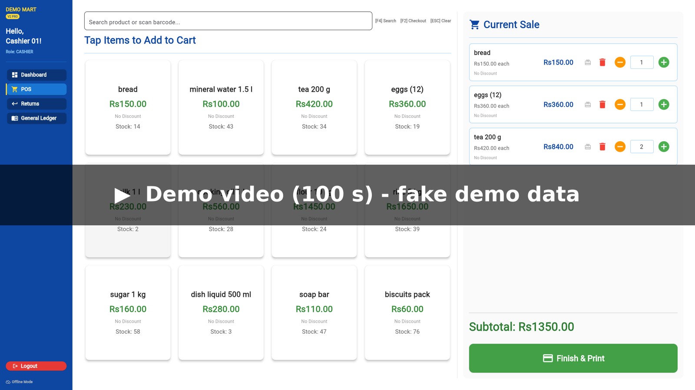
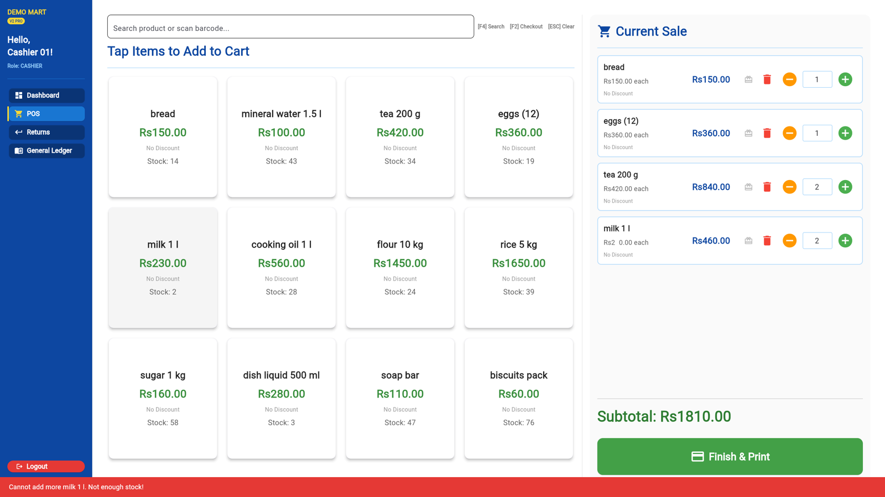
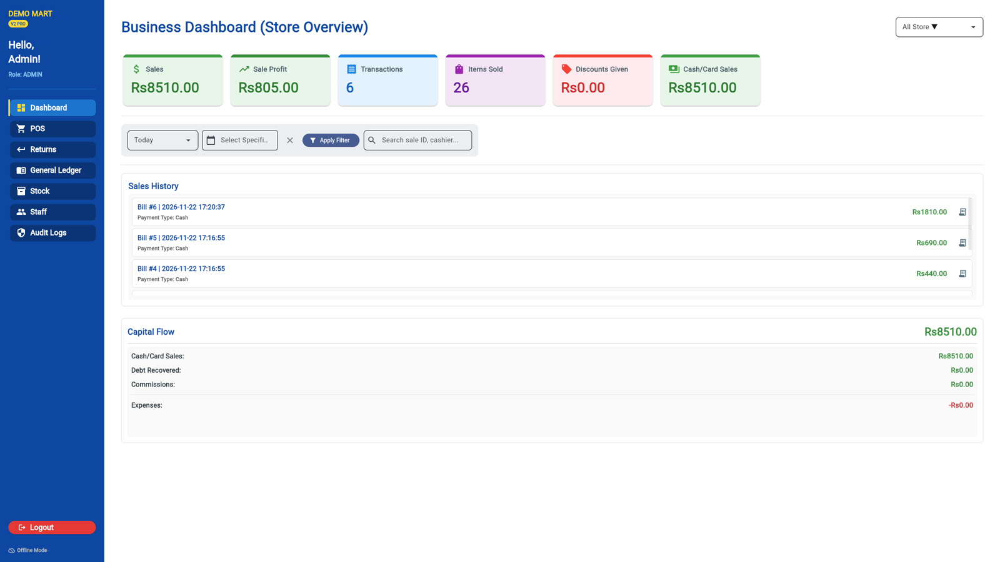
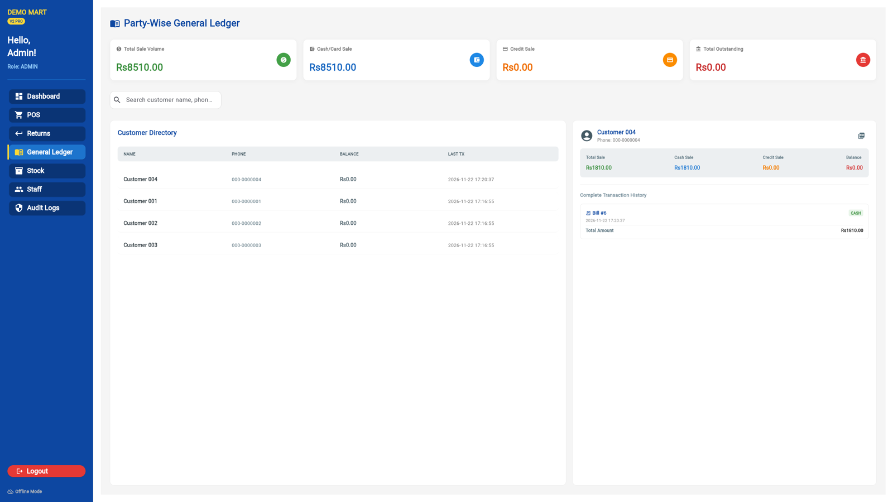
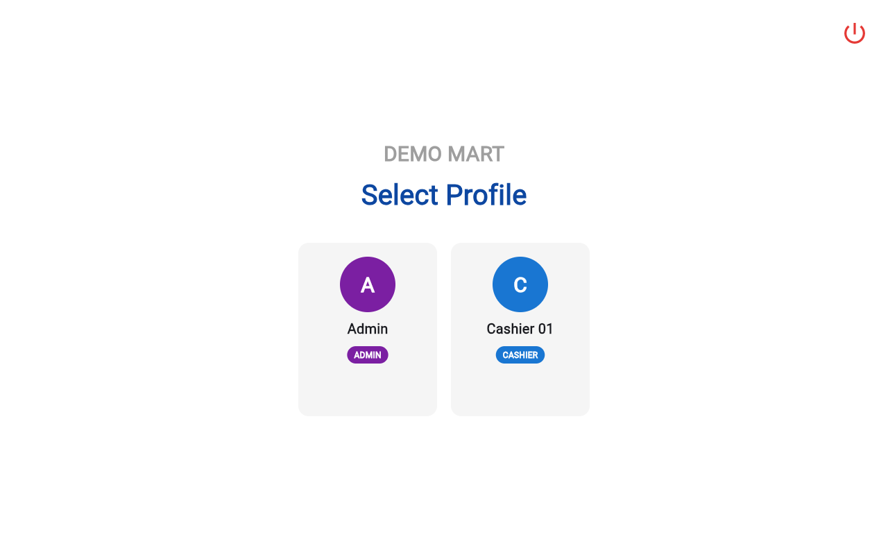
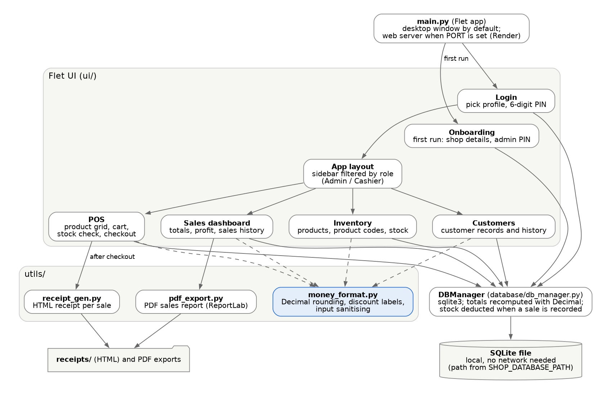
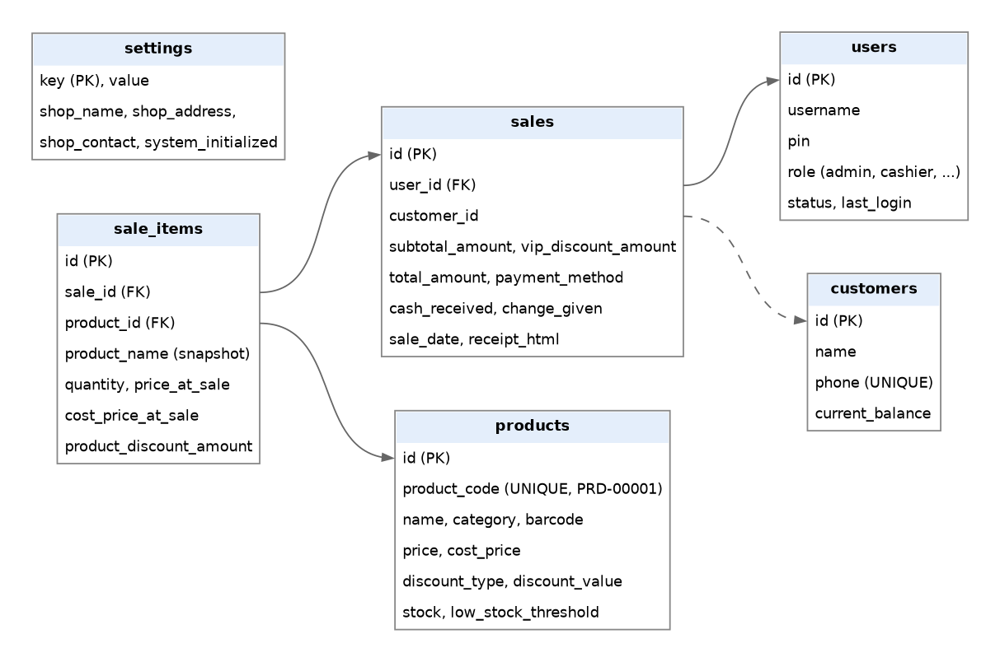

# My Local Shop

[](https://github.com/shoaib-javeed-05/my-local-shop-pos/actions/workflows/tests.yml)

**An offline-first point-of-sale and inventory app for small retail shops, built with Python, Flet and SQLite.**
Sold to and used by a mobile-network franchise retail shop in Pakistan.

> This is a public showcase. The full source code is in a private repository because the app was sold to a client. This repository contains the architecture, the data model, screenshots, a demo video, and one self-contained module with its unit tests. I am happy to walk through the private code on request.

**Live demo:** https://offline-pos-r3g6.onrender.com. It runs the same app as a web server on free hosting, so the Python code stays on the server and is not sent to the browser. The first load can take about a minute. It starts on the first-run setup screen with an empty database, which is shared by every visitor and is cleared when the free instance restarts. Please enter made-up data only.


*Point of sale, logged in as a cashier. All names and numbers in the screenshots and the video are fake demo data ("Demo Mart").*

## Demo video (100 seconds)

[](docs/video/demo.mp4)

A cashier logs in with a PIN, adds items to the cart, tries to sell more dish liquid than is in stock, and completes a cash sale. Then the admin logs in and opens the sales dashboard, the inventory and the customer records. **Recorded on a local copy of the app with fake demo data, not with a real shop's data.**

---

## The problem

Small shops often have slow or unreliable internet, and a point of sale that needs a connection stops working when it drops. My Local Shop keeps everything on the shop's own computer in a local SQLite database, so checkout, stock and reports work without a network connection.

## Features

| Feature | What it does | Screenshot |
|---|---|---|
| Checkout with cart and stock validation | Tap or scan products into a cart, change quantities, take cash and show the change. The cart cannot hold more of a product than is in stock. | [Cart](docs/screenshots/pos-cart.png), [stock check](docs/screenshots/pos-stock-validation.png), [payment](docs/screenshots/checkout.png) |
| Inventory with product codes | Each product gets a unique code (`PRD-00001`, ...), with category, barcode, cost and sale price, and stock level. | [Inventory](docs/screenshots/inventory.png) |
| Customer records | Customers are saved from the checkout (name and phone) with their purchase history. | [Customers](docs/screenshots/customers.png) |
| Sales reporting | Sales, profit, transactions and items sold for a chosen period, with the list of bills. | [Dashboard](docs/screenshots/sales-dashboard.png) |
| Receipt generation | An HTML receipt for every sale, ready to print. Sales reports can be exported as PDF. | [Receipt](docs/screenshots/receipt.png) |
| Role-based access (Admin / Cashier) | Each user picks a profile and enters a 6-digit PIN. A cashier sees fewer screens than the admin, who also has the stock and staff screens. | [Login](docs/screenshots/login-profiles.png) |

<p>
  
  
</p>
<p>
  
  
</p>
<p>
  
  
  
</p>

## Architecture and data model



`main.py` starts a Flet app: a desktop window by default, or a web server when a `PORT` is set (that is how the live demo runs). On first run an onboarding screen asks for the shop details and the admin PIN; after that, users log in with a profile and a 6-digit PIN, and the sidebar only shows the screens their role may open. All screens read and write through one database class (`DBManager`) over Python's `sqlite3`. When a sale is recorded, the subtotal, discount and total are recomputed from the cart items with `Decimal`, and stock is deducted. Money is formatted and rounded by `utils/money_format.py`, the module published in this repository.



The diagram shows the core tables behind the features above, with a subset of their columns. Graphviz sources are in [`docs/diagrams/src/`](docs/diagrams/src/).

## Tech stack

- **Python** with **Flet** 0.86 for the user interface (desktop window, also served as a web app)
- **SQLite** through Python's `sqlite3`; `Decimal` for money
- **asyncio**, through Flet's async event handlers (checkout, barcode scanning, login)
- **ReportLab** for PDF report export; receipts are generated as HTML
- **PyInstaller** for the Windows build
- **Render** for the web demo
- This repository: **pytest** and **GitHub Actions**

## What is in this repository

```
utils/money_format.py      copied unchanged from the private app: Decimal rounding (half-up),
                           money and percent formatting, discount labels, input sanitising
utils/config.py            a one-line stand-in for the app's config (currency symbol only)
tests/                     unit tests for money_format.py (standard library + pytest)
docs/diagrams/             architecture and data model (PNG + Graphviz sources in src/)
docs/screenshots/          screenshots taken on a local copy with fake demo data
docs/video/demo.mp4        the demo video
.github/workflows/tests.yml  runs the tests on every push
```

Not in this repository: the Flet screens, the database layer, the receipt and PDF code, the Windows build files, and any shop data.

Run the tests:

```bash
pip install pytest
pytest -q
```

## On AI tools

> **[PLACEHOLDER: to be written by Shoaib before publishing.]**

## Contact

Shoaib Javeed · [dev@shoaibjaveed.me](mailto:dev@shoaibjaveed.me)
