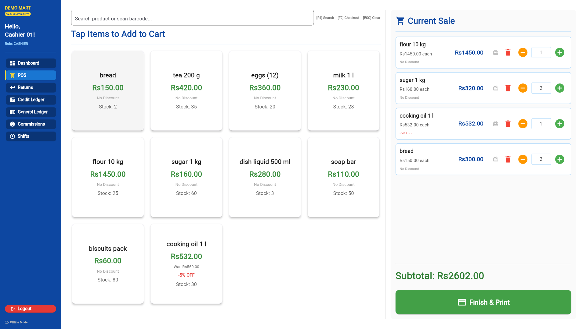
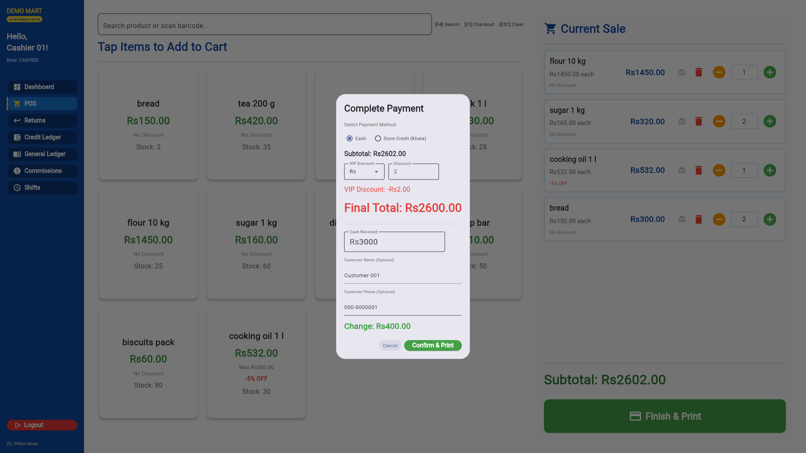
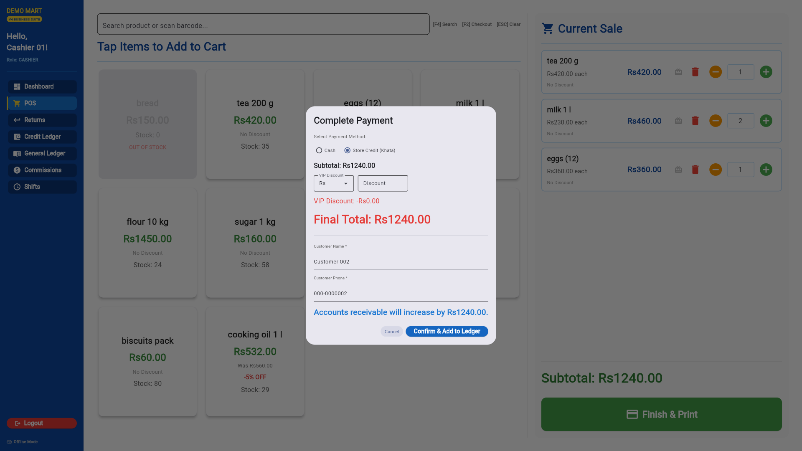
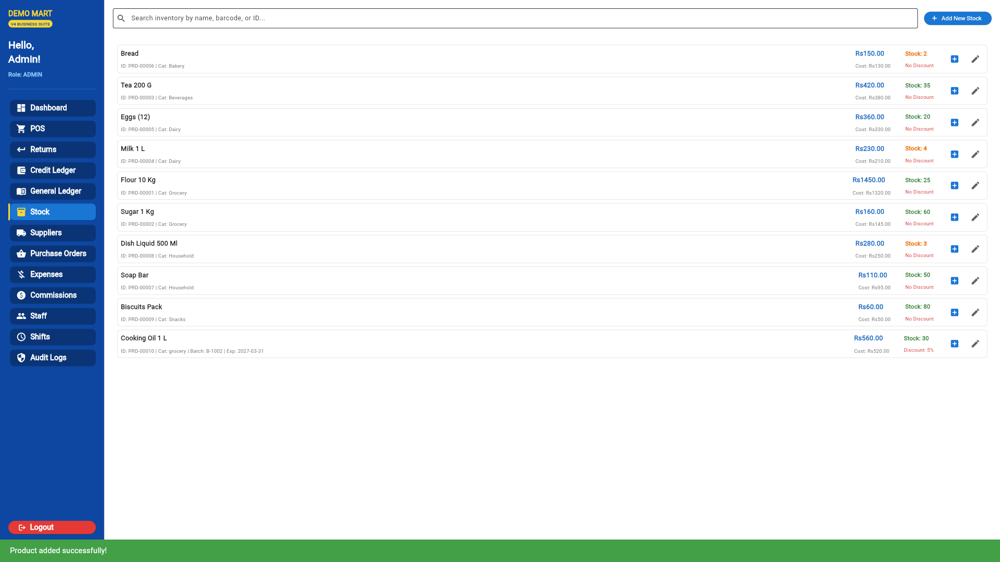
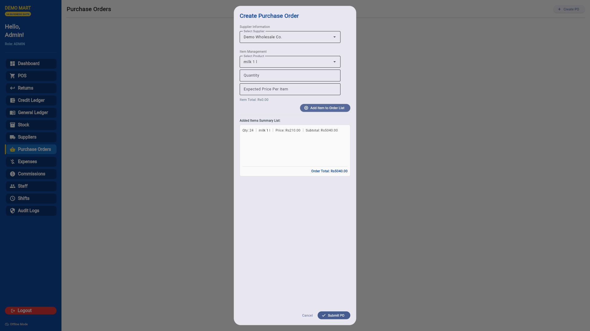
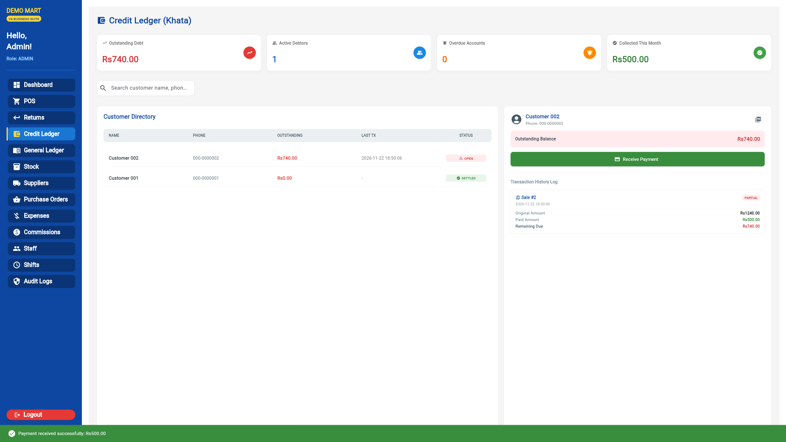
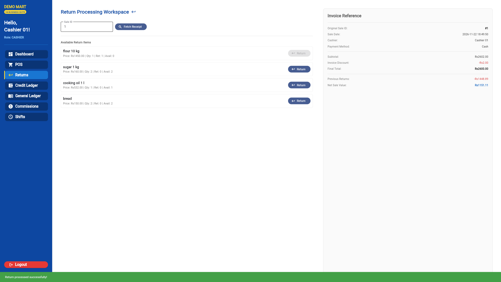
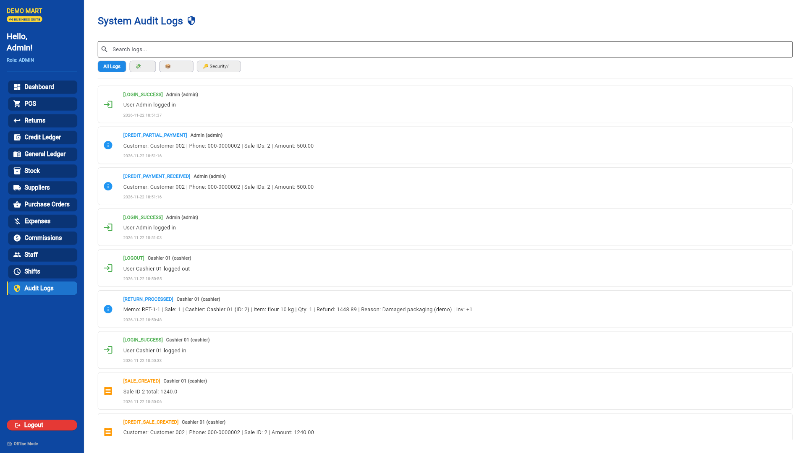
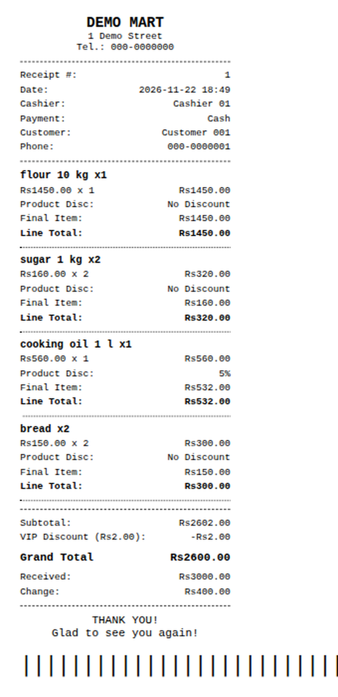
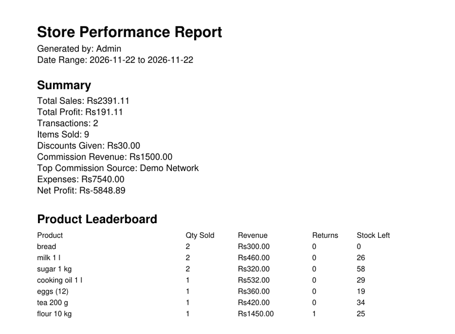

# My Local Shop

[](https://github.com/shoaib-javeed-05/my-local-shop-pos/actions/workflows/tests.yml)

**An offline-first point-of-sale, inventory and back-office app for small retail shops, built with Python, Flet and SQLite.**
Sold to and used by a mobile-network franchise retail shop in Pakistan.

> This is a public showcase. The full source code is in a private repository because the app was sold to a client. This repository contains the architecture, the data model, screenshots, a demo video, and one self-contained module with its unit tests. I am happy to walk through the private code on request.

**Live demo:** https://offline-pos-r3g6.onrender.com. It runs the same app as a web server on free hosting, so the Python code stays on the server and is not sent to the browser. The first load can take about a minute. It starts on the first-run setup screen with an empty database, which is shared by every visitor and is cleared when the free instance restarts. Please enter made-up data only.

## Demo video (2½ minutes)

[]([docs/video/demo.mp4)](https://youtu.be/WT2TpGqce9U)

First-run setup, PIN login, adding stock, a purchase order from a supplier, staff, expenses and commissions, then a cashier's checkout, a store-credit sale and a return, and finally the admin's credit ledger, sales dashboard, PDF report, customer records, audit log and printed receipt. **Recorded on a local copy of the app with fake demo data ("Demo Mart").** Chapter times are in [`docs/video/youtube-chapters.txt`](docs/video/youtube-chapters.txt).


*Point of sale, logged in as a cashier: the cart applies a 5% product discount to cooking oil. All names and numbers in the screenshots and the video are fake.*

---

## The problem

Small shops often have slow or unreliable internet, and a point of sale that needs a connection stops working when it drops. My Local Shop keeps everything on the shop's own computer in a local SQLite database, so selling, stock, credit and reports work without a network connection.

## Features

**Selling**

| Feature | What it does | Screenshot |
|---|---|---|
| Checkout | Tap products, search, or scan a barcode (keyboard shortcuts F4 search, F2 checkout, Esc clear); change quantities; take cash and show the change. | [Cart](docs/screenshots/pos-cart.png), [payment](docs/screenshots/checkout.png) |
| Stock check | The cart cannot hold more than the stock on hand; out-of-stock products are disabled. | shown in the video |
| Discounts | Per-product discounts (percent or fixed amount) and an invoice discount at checkout. | [Payment](docs/screenshots/checkout.png) |
| Store credit (khata) | Sell on credit to a named customer; the amount goes to their balance. | [Credit sale](docs/screenshots/credit-sale.png) |
| Receipts | An HTML receipt for every sale, with discounts, cash received and change. The receipt is also stored with the sale. | [Receipt](docs/screenshots/receipt.png) |
| Returns | Look up a bill, return part of a line; the refund takes the invoice discount into account and the stock goes back. | [Returns](docs/screenshots/returns.png) |

**Customers**

| Feature | What it does | Screenshot |
|---|---|---|
| Credit ledger | Outstanding balances per customer and part payments against them. | [Credit ledger](docs/screenshots/credit-ledger.png) |
| Customer records | Customers saved from checkout (name and phone), with totals and purchase history. | [Customers](docs/screenshots/customers.png) |

**Stock and back office**

| Feature | What it does | Screenshot |
|---|---|---|
| Inventory | Unique product codes (`PRD-00001`, ...), category, barcode, cost and sale price, stock, low-stock threshold, batch number, manufacturing and expiry dates. | [Inventory](docs/screenshots/inventory.png), [add product](docs/screenshots/add-product.png) |
| Suppliers and purchase orders | Supplier records; purchase orders with items and expected prices. Receiving an order needs the PIN, adds the stock, and logs the cost as an expense. | [Suppliers](docs/screenshots/suppliers.png), [purchase order](docs/screenshots/purchase-order.png) |
| Expenses | Expenses by category (rent, utilities, transport, salaries, maintenance, inventory purchase, other), confirmed with the PIN. | [Expenses](docs/screenshots/expenses.png) |
| Commissions | Commission income by source and type (direct or milestone) with a target count, totals and the top source. | [Commissions](docs/screenshots/commissions.png) |

**Reporting and control**

| Feature | What it does | Screenshot |
|---|---|---|
| Sales dashboard | Sales, profit, transactions, items sold, discounts, credit sales, outstanding debt, debt recovered, commissions, expenses and net profit; filters from today to this year or a specific date; sales history, product leaderboard, expense breakdown and purchase-order summary. | [Dashboard](docs/screenshots/sales-dashboard.png) |
| PDF report | Export the dashboard as a PDF report (ReportLab). | [PDF report](docs/screenshots/pdf-report.png) |
| Users, roles and PINs | First-run setup creates the admin; each user picks a profile and enters a 6-digit PIN. Roles are Admin, Manager and Cashier, and each role sees only its own menu. Staff can be added, have their PIN reset, or be deactivated. | [Setup](docs/screenshots/setup.png), [login](docs/screenshots/login-profiles.png), [cashier menu](docs/screenshots/cashier-menu.png), [staff](docs/screenshots/staff.png) |
| Audit log | Logins, sales, returns, payments and staff changes are logged, with filters. | [Audit log](docs/screenshots/audit-log.png) |

Which screens are available is also set per edition in the app's configuration; the screenshots and the video use the full edition ("V4 Business Suite" in the sidebar).

<p>
  
  
</p>
<p>
  
  
</p>
<p>
  
  
</p>
<p>
  
  
</p>
<p>
  
  
  
</p>

## Architecture and data model


`main.py` starts a Flet app: a desktop window by default, or a web server when a `PORT` is set (that is how the live demo runs). On first run a setup screen asks for the shop details and the admin PIN; after that, users log in with a profile and a 6-digit PIN, and `feature_guard.py` decides which screens their role and the edition allow. All screens read and write through one database class (`DBManager`) over Python's `sqlite3`. When a sale is recorded, the subtotal, discount and total are recomputed from the cart items with `Decimal`; stock goes down on a sale and back up on a return or a received purchase order. Money is formatted and rounded by `utils/money_format.py`, the module published in this repository.


The diagram shows the main tables with a subset of their columns. Graphviz sources are in [`docs/diagrams/src/`](docs/diagrams/src/).

## Tech stack

- **Python** with **Flet** 0.86 for the user interface (desktop window, also served as a web app)
- **SQLite** through Python's `sqlite3`; `Decimal` for money
- **asyncio**, through Flet's async event handlers (checkout, barcode scanning, login)
- **ReportLab** for the PDF report; receipts are generated as HTML
- **PyInstaller** for the Windows build
- **Render** for the web demo
- This repository: **pytest** and **GitHub Actions**

## What is in this repository

```
utils/money_format.py      copied unchanged from the private app: Decimal rounding (half-up),
                           money and percent formatting, discount labels, input sanitising
utils/config.py            a one-line stand-in for the app's config (currency symbol only)
tests/                     unit tests for money_format.py (standard library + pytest)
docs/diagrams/             architecture and data model (PNG + Graphviz sources in src/)
docs/screenshots/          screenshots taken on a local copy with fake demo data
docs/video/                the demo video and its chapter list
.github/workflows/tests.yml  runs the tests on every push
```

Not in this repository: the Flet screens, the database layer, the receipt and PDF code, the Windows build files, and any shop data.

Run the tests:

```bash
pip install pytest
pytest -q
```

## On AI tools

I used AI coding assistants (such as Codex and Claude) throughout the development of the app. I designed the data model and the shop workflows, and I tested the features in the running app.

This public showcase (the screenshots, the demo video, the diagrams, the tests and this README) was prepared with Claude Code, an AI coding agent, in November 2026, working from the private code and a local copy of the app with fake data. Using the app end to end for the video also surfaced bugs that are still open in the private code; for example, closing a cashier's shift fails because the code writes to columns that the shifts table does not have.

## Contact

Shoaib Javeed · [dev@shoaibjaveed.me](mailto:dev@shoaibjaveed.me)
